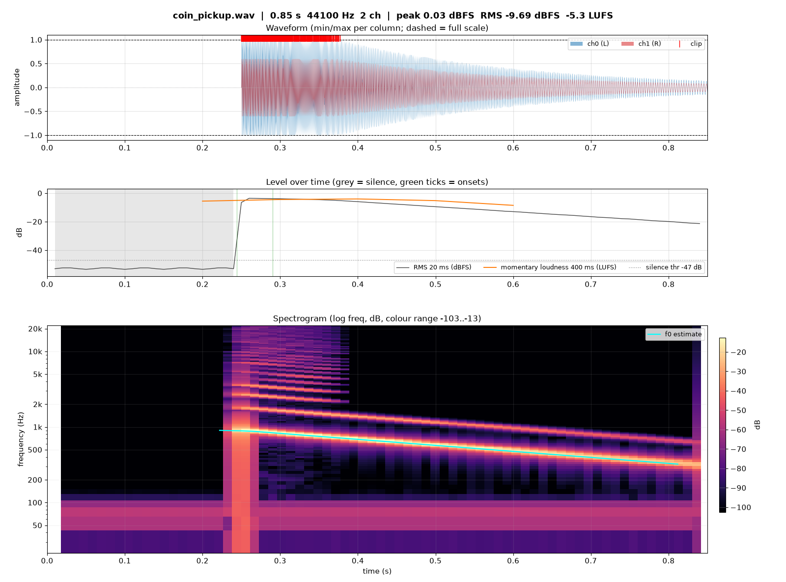
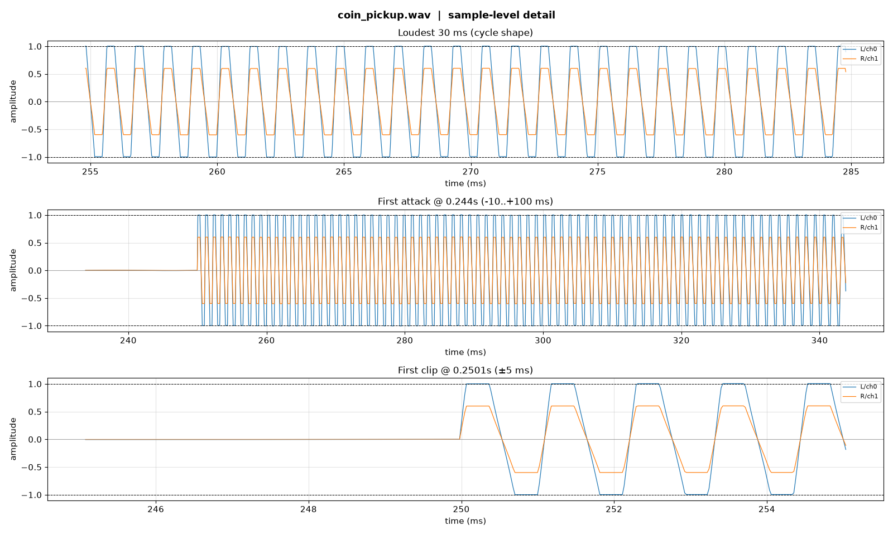

# sound-reader

**A skill that lets Claude and Codex "read" sound.**
LLMs can't hear audio. They can read images and numbers, though. sound-reader turns an audio file into
**images** (waveform, loudness curve, spectrogram, spectrum, sample-level zoom) and **exact measurements**
(LUFS, true peak, clipping, noise floor, hum, onsets/tempo, pitch, key, stereo phase), so an agent can look at a sound and analyse it.

It works for any kind of sound: game/UI sound effects, music, voice recordings, TTS output, and debugging an audio pipeline.

> It is not just a spectrogram renderer. It **measures** (BS.1770 loudness, flat-top clipping, hum, …), **raises automatic warnings** (`flags`),
> and ships an **interpretation guide** (`references/interpretation.md`) that tells the agent what each pattern in the images means, so the agent can diagnose the sound itself.
> It runs on pure Python (numpy/scipy/matplotlib), so no separate binary install is needed.

## Demo: "Is anything wrong with this coin sound?"

[`docs/examples/coin_pickup.wav`](docs/examples/coin_pickup.wav) has 5 defects planted in it. We gave this file to an agent
with no prior context, together with only this skill's `SKILL.md`, and asked:

> I'm making a coin pickup sound for my game. I'm not sure it sounds right — can you check whether there are any problems?

The agent ran the analyzer, looked at the images, and answered (excerpt):

> 1. **It's clipping.** The left channel sits flat against full scale from 0.250 to 0.38 s (1,536 samples, 96 runs), and the true peak is +0.18 dBTP. The spectrogram also shows harmonics up to 20 kHz appearing only during that stretch.
> 2. **The end is cut off, so it will click.** The last sample is at −0.128 (about −18 dBFS). Add a 5–20 ms fade-out.
> 3. **There is 0.25 s of silence before the sound starts.** That is a quarter-second delay after touching the coin. Trim the start.
> 4. **There is a 60 Hz hum underneath.** About −48 dBFS, present even in the silent lead-in. A high-pass at 100–150 Hz fixes it.
> 5. **Left/right imbalance of 4.4 dB.** The sound leans left.
>
> *Design note:* the pitch falls from 870 → 330 Hz. Coin sounds usually rise, and falling pitch reads as "fail / lose".

It found all 5 planted defects and also raised a design issue nobody had told it about.

| overview.png | detail.png |
|---|---|
|  |  |

Other real-world tests: it split a set of 6 UI sound effects by note and purpose (positive = rising, error = falling), and it worked out a 3:38 electronic track's intro → filter opening → riser → drop structure along with its mastering state (−9.5 LUFS, +0.94 dBTP).

## Installation

Prerequisites: Python 3.9+, `numpy scipy matplotlib` (`pip install -r requirements.txt`).
To read formats other than WAV (mp3, m4a, ogg, flac, video, ...) you also need `ffmpeg`.

### Claude Code: plugin (recommended)

```
/plugin marketplace add presentY1897/sound-reader
/plugin install sound-reader@sound-reader
```

If you have no GitHub SSH key and the first line fails to clone, use the HTTPS address instead:
`/plugin marketplace add https://github.com/presentY1897/sound-reader.git`

The plugin installs only the skill. The Python packages have to be installed separately (`pip install numpy scipy matplotlib`).

### Claude app (claude.ai / desktop)

1. Download `sound-reader.zip` from the [latest release](https://github.com/presentY1897/sound-reader/releases/latest).
2. In the Claude app, enable **Settings → Capabilities → Code execution and file creation**.
3. In the same screen, go to **Skills → Upload skill** and upload the zip.
4. Attach an audio file to a conversation and ask, for example, "Analyse this sound".

In the Claude app the analysis runs in its code execution sandbox. WAV works reliably. Formats such as mp3 or ogg
depend on whether the sandbox has `ffmpeg` or `soundfile`. If they fail, convert to WAV first.

### Claude Code / Codex: clone + install script

```bash
git clone https://github.com/presentY1897/sound-reader.git
cd sound-reader
pip install -r requirements.txt
./install.sh          # symlinks into whichever of ~/.claude/skills and ~/.codex/skills exists
# ./install.sh codex  # Codex only
# ./install.sh claude # Claude Code only
# ./install.sh --copy # copy instead of symlink
```

Because it uses symlinks, `git pull` alone updates the skill.

### Manual install

Copy the `skills/sound-reader/` folder to `~/.claude/skills/sound-reader/` (Claude Code) or
`~/.codex/skills/sound-reader/` (Codex). To use it in a single project only, put it under that project's `.claude/skills/`.

## Usage

Once installed, just mention an audio file in a conversation and the skill is picked up automatically.

> "Check whether `assets/sfx/jump.wav` clips or has a click"
> "Compare the loudness and tonal balance of these two mixes: `mix_v1.wav` and `mix_v2.wav`"
> "Is there noise or hum in this recording? `interview.m4a`"
> "Our synth output sounds weird. Is it a pitch problem? `out/render_440.wav`"

You can also run the script directly:

```bash
python3 skills/sound-reader/scripts/sound_reader.py analyze input.wav [--out DIR] [--start S --end S] [--music] [--linear-freq]
python3 skills/sound-reader/scripts/sound_reader.py compare a.wav b.wav [--out DIR]
```

| Output | Contents |
|---|---|
| `overview.png` | waveform · RMS / momentary LUFS (silence and onsets marked) · log-frequency spectrogram + f0 track (· chromagram with `--music`) |
| `spectrum.png` | average spectrum with peaks labelled (Hz + note name) · energy per band |
| `detail.png` | sample-level zooms of the loudest moment, the first attack, and the first clip |
| `summary.json` | all measurements + automatic warnings (`flags`) |
| `events.csv` | one row per separate sound: length, peak, attack/decay, dominant note, pitch movement (rising/falling/rise-fall), held notes |
| `frames.csv` | time series (RMS, LUFS, f0, spectral peak, brightness): exact values in place of reading curves |
| `compare.png/json` | spectrum overlay, B−A difference, loudness comparison, **time-aligned spectrogram difference** (when and in which band the two differ), metric changes |

### On-demand views

The default analysis covers most questions. When the interpretation needs more, the agent renders only the view it needs:

```bash
python3 skills/sound-reader/scripts/sound_reader.py view input.wav --kind <kind> [--event N]
```

| kind | Shows |
|---|---|
| `events` | every sound side by side on the same scale (contact sheet) |
| `envelope` | attack / decay / end-cut markers per event |
| `pianoroll` | semitone-resolution spectrogram (which notes, when) |
| `harmonics` | harmonic structure: odd/even balance, brightness (tilt), inharmonic partials (bell / metal) |
| `hpss` | tonal part vs. percussive part |
| `structure` | self-similarity matrix and section repeats (A/B/A…) |
| `stereo` | vectorscope, correlation over time, pan per band |
| `reverb` | decay curves, EDT/T20/T30 |
| `loop` | loop seam check (click, level and timbre jumps). Pass a loop range with `--start/--end`; it is judged against the song's natural continuation |
| `loopfind` | suggests bar-aligned loop points for BGM (seconds and samples, seams checked) |

## What it measures

- **Level**: peak, true peak (4× oversampled), RMS, crest factor, ITU-R BS.1770 integrated / momentary / short-term LUFS, LRA, DC offset
- **Integrity**: clipping (flat-top detection), samples over full scale, leading/trailing silence, silence regions
- **Noise**: noise floor, SNR estimate, 50/60 Hz mains hum detection, band-limiting (lossy / upsampled) detection
- **Spectrum**: centroid, rolloff, flatness, effective bandwidth, energy share across 7 bands, dominant peaks (with note names)
- **Rhythm**: onsets, tempo estimate, beat/bar grid (first downbeat, bar length)
- **Pitch / tonality**: f0 track and median (with note name), chroma, key estimate, per-sound pitch contour and held notes
- **Events**: automatic splitting at silence; per-sound envelope (attack/decay/end level) and pitch movement
- **Stereo**: L/R correlation (phase problems), side/mid ratio, balance, fake-stereo detection

## Scope and limits

**What it is for:** turning a sound's waveform and spectrum into images and numbers, so that an LLM can understand through images and measurements
*what the sound is like and what is wrong with it*: timbre, structure, level, noise, defects.

**What it does not do: extract text (speech-to-text).** sound-reader can tell that someone is speaking and how
(pitch, intonation, syllable structure, pauses, consonant and vowel character), but it does not determine *what* they said. Speech recognition needs a separate
trained model and a heavy runtime environment, which goes against this project's goal of staying light and dependency-free, so it is deliberately left out.

If you need the words, use a separate speech recognition (ASR / speech-to-text) tool. The options change quickly, so we don't
pin a specific recommendation here:

- **Up-to-date comparison:** [Hugging Face Open ASR Leaderboard](https://huggingface.co/spaces/hf-audio/open_asr_leaderboard)
- *Examples as of 2026-10 (may be outdated):* OpenAI Whisper family (local: `faster-whisper`), cloud STT APIs. Codex has OpenAI's `transcribe` skill.

**Other limits**
- f0 is reliable for monophonic sources (a single voice or instrument). For chords or a full mix it shows `pitch.reliable: false`.
- Tempo and key are estimates (tempo can be off by a factor of 2).
- It does not separate sources (vocals/drums) or classify sounds with a model ("this is a dog barking"). Identifying a sound is up to the LLM reasoning from the images and numbers.

## Development

```bash
python3 -m pytest tests/      # or: python3 tests/test_sound_reader.py
```

The tests generate synthetic signals with known properties (1 kHz sine = -3.01 LUFS, A4 = 440 Hz, a 120 BPM click track, 60 Hz hum, clipping,
polarity inversion, low-pass filtering, a C major progression) and check the measurements against those values.

## License

MIT
